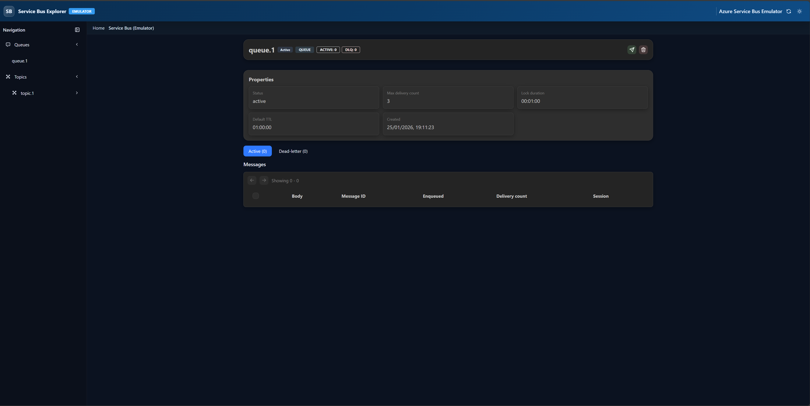

# Service Bus Emulator Explorer

A web-based UI for managing and exploring Azure Service Bus Emulator instances. This tool provides an intuitive interface to interact with queues, topics, subscriptions, and messages in the Azure Service Bus Emulator.



## 🚀 Features

### Queue Management

- **List and Create Queues**: View queues with active and dead-letter message counts
- **Send Messages**: Send messages with custom properties, content types, and session IDs
- **Peek Messages**: Preview messages in queues without consuming them
- **Purge Active Messages**: Remove active messages with partial-result and timeout reporting
- **Delete Queues**: Remove queues from the emulator
- **Dead Letter Queue Management**: Replay, edit, or bulk delete dead-letter messages

### Topic & Subscription Management

- **List and Create Topics**: Manage topics with real-time statistics
- **Send Messages to Topics**: Publish messages to topics for distribution to subscriptions
- **Subscription Management**: Create and manage subscriptions on topics
- **Peek Subscription Messages**: Preview messages in subscriptions
- **Subscription Recovery**: Replay or delete subscription dead-letter messages
- **Delete Topics/Subscriptions**: Clean up resources

### Message Operations

- **Message Peeking**: View message content and properties without consuming
- **Dead Letter Queue Recovery**: Replay selected or all messages while preserving broker metadata
- **Editable Replay**: Edit a message body and choose whether to remove the original from the DLQ
- **Bulk Operations**: Purge active messages and delete dead-letter messages
- **Message Editor**: Edit message content with Monaco syntax highlighting

### Developer Experience

- **Modern React UI**: Built with React 19, Vite, and Fluent UI/Mantine components
- **Real-time Updates**: Automatic refresh of entity statistics
- **Environment Visibility**: Display the current application environment in the header
- **Emulator-Aware Counts**: Show bounded count estimates when exact runtime counts are unavailable
- **API Documentation**: OpenAPI/Scalar API documentation available
- **Monaco Editor**: In-browser code editor for message content
- **Observability**: Built-in OpenTelemetry support

## 📋 Prerequisites

- Docker and Docker Compose
- .NET 10.0 SDK (for local development)
- Node.js 24 and npm (for frontend development)

## 🛠️ Setup

### Using Docker Compose (Recommended)

1. **Clone the repository**

   ```bash
   git clone <repository-url>
   cd Service-Bus-Emulator-Explorer
   ```

2. **Set environment variables**

   Create a `.env` file in the root directory:

   ```env
   ACCEPT_EULA=Y
   SQL_PASSWORD=YourStrongPassword123!
   ```

3. **Start the services**

   ```bash
   docker compose up
   ```

   This will start:
   - Service Bus Emulator on ports `5672` (AMQP) and `5300` (Admin)
   - SQL Server (required by the emulator)
   - Service Bus Explorer UI on port `8080`

4. **Access the application**
   - Web UI: <http://localhost:8080>
   - API: <http://localhost:8080/api>
   - API Documentation: <http://localhost:8080/scalar/v1>

### Publishing beta Docker images

Repository maintainers with write access can publish an image from an existing branch:

1. Open **Actions → Publish beta image → Run workflow**.
2. Leave the workflow's **Use workflow from** selection on `main`, and enter the source branch in the **branch** input (for example `fix/purge-receiver-lifetime`). The source branch does not need to contain the beta workflow.
3. The workflow resolves the branch to a commit, runs the frontend build and backend tests, then publishes that same commit to `ghcr.io/tombiddulph/service-bus-emulator-explorer`.
4. Copy the `docker pull` command from the workflow run's summary.

Each publication creates a unique version tag such as `1.2.3-beta.12.1` and updates a branch-specific tag such as `beta-fix-purge-receiver-lifetime-<branch-hash>`. The branch hash prevents collisions between similar branch names. The summary also includes a digest-pinned pull command. Beta publications never update `latest` or stable version tags.

Alternatively, using GitHub CLI:

```bash
gh workflow run beta.yml --ref main -f branch=fix/purge-receiver-lifetime
```

Only branches in this repository are accepted, not tags, commit IDs, or fork branches. Review branch code before publishing: builds execute the selected branch's scripts and Dockerfile. Ordinary branch pushes and PRs do not publish beta images.

### Local Development Setup

For the complete bundled frontend and backend workflow, including `.env` configuration, see [Run Locally With .env](RUN_LOCAL.md).

#### Backend (.NET)

Start the emulator dependencies, then run the backend from the repository root:

```bash
docker compose -f compose-services.yaml up -d
dotnet run --project src/ServiceBusEmulatorExplorer
```

The API will be available at <http://localhost:5123>.

#### Frontend (React)

1. **Navigate to the frontend directory**

   ```bash
   cd app/sb-explorer-ui
   ```

2. **Install dependencies**

   ```bash
   npm ci
   ```

3. **Run the development server**

   ```bash
   npm run dev
   ```

   The UI will be available at <http://localhost:5173>

4. **Build for production**

   ```bash
   npm run build
   ```

## 🔧 Configuration

### Backend Configuration (`appsettings.json`)

```json
{
  "ServiceBus": {
    "ConnectionString": "Endpoint=sb://localhost;SharedAccessKeyName=RootManageSharedAccessKey;SharedAccessKey=SAS_KEY_VALUE;UseDevelopmentEmulator=true;",
    "AdministrationConnectionString": "Endpoint=sb://localhost:5300;SharedAccessKeyName=RootManageSharedAccessKey;SharedAccessKey=SAS_KEY_VALUE;UseDevelopmentEmulator=true;",
    "EmulatorConfigFilePath": "service-bus-config.json"
  },
  "Explorer": {
    "ReadOnly": false,
    "RefreshIntervalMs": 8000
  },
  "Otlp": {
    "Endpoint": "https://your-otel-endpoint",
    "Headers": ""
  }
}
```

### Observability Configuration

- `Otlp:Endpoint`: OTLP collector endpoint for OpenTelemetry
- `Otlp:Headers`: Additional headers for OTLP exporter
- `Otlp:EnableConsoleExporter`: Enable console exporter for debugging

### Frontend Configuration

Environment variables for the frontend (via `.env` or build scripts):

- `VITE_API_BASE_URL`: Backend API base URL (default: `/api`)
- `VITE_USE_MOCK`: Enable/disable mock data (for development)

Run `npm run dev:mock` for a standalone demo without Docker or the backend.
Run `npm run dev:partial` to mock only DLQ operations while using the real API elsewhere.

### Explorer Configuration

- `Explorer__ReadOnly=true`: server-enforced read-only access; defaults to false.
- `Explorer__RefreshIntervalMs`: default UI polling interval, clamped to 1000–60000 ms; defaults to 8000.
- `Explorer__AllowedOrigins__0`: permitted development CORS origin. Defaults allow localhost/127.0.0.1 on port 5173.

The header can pause/resume automatic refresh and override its interval. Polling
pauses in hidden tabs. Count estimates are cached for two seconds and invalidated
after mutation requests. Message pages use sequence-number cursors; offsets remain
supported for existing clients. A message arriving or disappearing during browsing
can change page contents, so displayed page ranges are not stable broker indexes.

See [safe deployment](docs/DEPLOYMENT.md) and [health, metrics and API contracts](docs/OBSERVABILITY.md).
Queue and subscription creation defaults TTL to one hour, matching the emulator's
maximum. Invalid names, delivery counts, durations and TTLs return field-specific
validation problems rather than silently changing the requested settings.
Compose emulator and SQL dependencies are pinned by digest. Enable Renovate on this
repository to receive update proposals from `.github/renovate.json`.

## 📚 API Endpoints

### Queues

- `GET /api/queues` - List all queues
- `POST /api/queues` - Create a new queue
- `DELETE /api/queues/{name}` - Delete a queue
- `GET /api/queues/{name}/messages` - Peek messages in a queue
- `POST /api/queues/{name}/messages` - Send message to a queue
- `POST /api/queues/{name}/purge` - Purge active queue messages

### Topics

- `GET /api/topics` - List all topics
- `POST /api/topics` - Create a new topic
- `DELETE /api/topics/{name}` - Delete a topic
- `POST /api/topics/{topic}/messages` - Send message to a topic

### Subscriptions

- `GET /api/topics/{topic}/subscriptions` - List subscriptions
- `POST /api/topics/{topic}/subscriptions` - Create a subscription
- `DELETE /api/topics/{topic}/subscriptions/{sub}` - Delete a subscription
- `GET /api/topics/{topic}/subscriptions/{sub}/messages` - Peek subscription messages
- `POST /api/topics/{topic}/subscriptions/{sub}/purge` - Purge active subscription messages

### Dead Letter

- `POST /api/deadletter/queue/{name}/delete` - Bulk delete queue DLQ messages
- `POST /api/deadletter/queue/{name}/replay` - Replay queue DLQ messages
- `POST /api/deadletter/subscription/{topic}/{sub}/delete` - Bulk delete subscription DLQ messages
- `POST /api/deadletter/subscription/{topic}/{sub}/replay` - Replay subscription DLQ messages

### Application

- `GET /api/environment` - Get the current host environment

### Message Peek Behaviour

Queue and subscription message peeks accept `skip` from 0 to 10000 and `take`
from 1 to 250 (defaults: 0 and 25). Invalid pagination returns a 400 validation
problem. Peeks have a 10-second deadline, including time spent waiting for the
entity operation lock, and are cancelled when the HTTP request is aborted.
Missing entities return 404, broker connection failures return 503, and timeouts
return 504 rather than a successful empty page. The UI offers Retry and labels
previously loaded messages as stale when a refresh fails.

## 🧪 Testing

Run the test suite from the repository root:

```bash
dotnet run --project test/ServiceBusEmulatorExplorer.Tests/ServiceBusEmulatorExplorer.Tests.csproj --configuration Release
```

Run all local CI checks with Node.js 24 and .NET 10:

```bash
node scripts/verify.mjs
```

This installs frontend dependencies, builds and lints, runs Vitest and Playwright,
restores/builds .NET, runs the fake-backed TUnit suite, and checks generated API
contracts. It does not require Docker. On Linux, install browser system dependencies
first with `npx playwright install --with-deps chromium` in the frontend directory.
Use `--skip-browser` only for a partial verification run.

Real-emulator checks are isolated in the **Emulator integration** workflow: it
builds the published AOT image, starts `test/compose.integration.yaml`, tests broker
send/peek/DLQ recovery/purge and topic subscriptions, and always cleans up its
disposable stack. To reproduce locally, build the image as `sb-explorer:integration`,
set a complexity-compliant `SQL_PASSWORD`, start that Compose file under a separate
project name, and run `dotnet run --project test/ServiceBusEmulatorExplorer.Integration`.
Only run these tests against a disposable emulator; they create and delete entities.

## 🏗️ Project Structure

```
Service-Bus-Emulator-Explorer/
├── app/
│   └── sb-explorer-ui/          # React frontend
│       ├── src/
│       │   ├── api/             # API client and hooks
│       │   ├── components/      # React components
│       │   └── routes/          # Page components
│       └── package.json
├── src/
│   └── ServiceBusEmulatorExplorer/  # .NET backend
│       ├── Endpoints/           # API endpoints
│       ├── Extensions/          # Service extensions
│       └── Program.cs           # Application entry point
├── test/
│   └── ServiceBusEmulatorExplorer.Tests/  # Unit tests
├── compose.yaml                 # Docker Compose configuration
└── sb-explorer.slnx             # .NET solution file
```

## 🐳 Docker

### Build Custom Image

```bash
docker build -t sb-explorer:local -f src/ServiceBusEmulatorExplorer/Dockerfile .
```

### Run with Custom Image

Update `compose.yaml` to use your local image:

```yaml
services:
  sb-explorer:
    image: sb-explorer:local
    # ... rest of configuration
```

## 🔍 Troubleshooting

### Service Bus Emulator Won't Start

- Ensure Docker is running
- Check that ports 5672 and 5300 are not in use
- Verify SQL password meets complexity requirements (uppercase, lowercase, numbers, special characters)
- Set `ACCEPT_EULA=Y` in your environment

### Connection Issues

- Verify the Service Bus emulator is running: `docker ps`
- Check connection strings in `appsettings.json`
- Ensure the emulator is accessible on the configured ports

### Frontend Can't Connect to Backend

- Verify backend is running on the expected port
- Check `VITE_API_BASE_URL` environment variable
- Review CORS configuration in `Program.cs`

## 📄 License

The frontend and backend code are licensed under the MIT License. See the [LICENSE](LICENSE) file for details.

## 🤖 Acknowledgements

The majority of the frontend code was written by OpenAI's ChatGPT codex model.

## ⚠️ Limitations

The administration client for the emulator does not expose all of the properties in some of the models, so some parts of the application may not show all available properties or invalid information.
